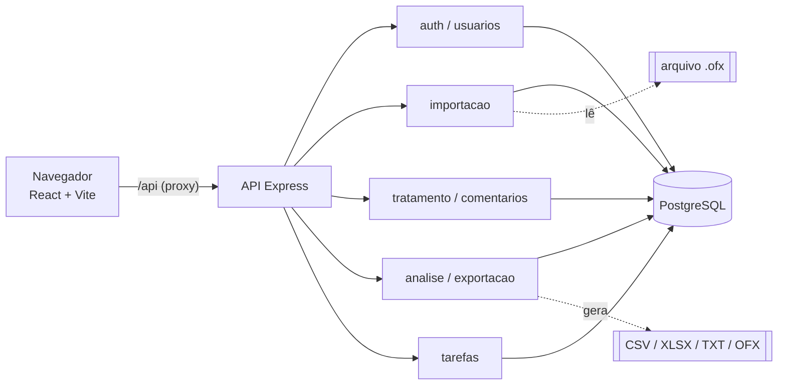

<div align="center">

# 💸 Fluxo Contábil

**Mini ERP financeiro que transforma extratos bancários OFX em informação: importa, classifica, analisa e exporta.**


</div>

---

## ✨ O que o sistema faz

- 📥 **Importa extratos OFX** (formato SGML dos bancos brasileiros) com **prévia antes de gravar** e detecção de contas duplicadas.
- 🏷️ **Classifica automaticamente** cada movimentação em categorias (aluguel, energia, folha...) e permite ajuste manual.
- 📊 **Painel de análise** com totais, gastos por categoria (pizza, rosca ou barras), comparação mensal e evolução do saldo.
- 📤 **Exporta** os dados tratados em **CSV, Excel (.xlsx), TXT ou OFX**.
- 🔐 **Login com 3 perfis** (analista fiscal, estagiário e gestor), cada um com permissões diferentes.
- 💬 **Comentários** do analista em cada conta e ✅ **tarefas delegadas** pelo gestor (ex.: "preciso do balanço de setembro").
- 🛡️ **Segurança de verdade no backend**: JWT de curta duração, refresh token com rotação, bcrypt, validação com zod, limite de tentativas de login e proteção contra CSV injection.

## 🧰 Tecnologias

| Camada | Tecnologias |
| --- | --- |
| Backend | Node.js 20, Express 4, `pg`, `zod`, `jsonwebtoken`, `bcryptjs`, `multer`, `exceljs`, `helmet`, `cors`, `express-rate-limit` |
| Banco | PostgreSQL (migrações SQL numeradas) |
| Frontend | React 18, Vite 5, Recharts, Lucide Icons |
| Testes | `node:test` (unitários e integração) e coleção do Insomnia com 78 testes |
| Documentação | Diagramas PlantUML (classes e DER) |

## 🏗️ Arquitetura



Cada requisição passa por **autenticar** (quem é você? → 401) e **autorizar** (o que você pode fazer? → 403). O backend e o frontend são organizados **por módulo**, com os mesmos nomes dos dois lados.

---

## Perfis de usuário

| | Analista fiscal | Estagiário | Gestor (head) |
| --- | :---: | :---: | :---: |
| Importar OFX / lançar conta manual | ✅ | ✅ | ❌ |
| Ver lista de contas | ✅ | ✅ | ✅ |
| Alterar categoria / classificar | ✅ | ❌ | ❌ |
| Escrever comentários nas contas | ✅ | ❌ | ❌ |
| Ler comentários | ✅ | ❌ | ✅ |
| Ver gráficos e análise | ✅ | ❌ | ✅ |
| Exportar relatórios | ✅ | ❌ | ✅ |
| Delegar tarefas (ex.: pedir balanço) | ❌ | ❌ | ✅ |
| Ver / atualizar as próprias tarefas | ✅ | ✅ | ✅ (vê todas) |
| Gerenciar usuários | ❌ | ❌ | ✅ |

A tabela é definida em um único arquivo: [backend-api/src/config/permissions.js](backend-api/src/config/permissions.js).

## Estrutura de pastas

```
fluxo-contabil/
├── database/                 # Banco de dados
│   └── migrations/           #   scripts SQL numerados (001_..., 002_...)
├── backend-api/              # API em Node.js + Express
│   ├── scripts/              #   migrate.js e seed.js
│   ├── test/                 #   testes automatizados
│   └── src/
│       ├── app.js, server.js
│       ├── config/           #   env.js e permissions.js
│       ├── shared/    #   db, erros e middlewares (autenticar, autorizar, validar)
│       └── modules/          #   uma pasta por módulo
│           ├── auth/         #     login, refresh, logout, trocar senha
│           ├── usuarios/     #     cadastro da equipe (gestor)
│           ├── importacao/   #     leitor de OFX + prévia + importação
│           ├── tratamento/   #     contas, categorias e classificação
│           ├── comentarios/  #     comentários do analista
│           ├── analise/      #     totais e gráficos
│           ├── exportacao/   #     csv, xlsx, txt, ofx
│           └── tarefas/      #     tarefas delegadas pelo gestor
├── api/                      # Documentação e testes da API
│   ├── insomnia/             #   coleção do Insomnia (78 requisições + testes)
│   ├── examples/             #   extratos .ofx para testar a importação
│   └── README.md             #   lista de rotas
├── diagrams/                 # Diagramas PlantUML (classes.puml, layers.puml e erd.puml)
├── env/                      # Variáveis de ambiente
│   └── .env.example          #   modelo (o .env de verdade não vai para o Git)
└── frontend/                 # React 18 + Vite
    └── src/
        ├── App.jsx, Sistema.jsx, MenuLateral.jsx   #   login x sistema, layout e menu filtrado pelas permissões
        ├── registroModulos.js  #   lista dos módulos (e a permissão de cada um)
        ├── shared/    #   componentes reutilizáveis (Botao, Campo, Tabela, Painel...), hooks (useRequisicao, useFormulario...) e http.js
        └── modules/          #   uma pasta por módulo (mesmos nomes do backend)
```

## Como rodar

**Pré-requisitos:** Node.js 20 ou superior e o PostgreSQL instalado (local ou na nuvem, como o [Neon](https://neon.tech)).

> ⚠️ Use um **banco só para este projeto** (ex.: `ofx_app`). As migrações criam as tabelas `usuarios`, `tarefas`, etc. e os testes de integração apagam dados, então nunca aponte o `.env` para o banco de outra aplicação.

### Passo a passo

**1. Criar o banco local** (uma vez só). No PowerShell, informe a senha do `postgres` quando pedir:

```powershell
& "C:\Program Files\PostgreSQL\18\bin\createdb.exe" -U postgres ofx_app
```

Ou, no pgAdmin: *Databases → Create → Database…* com o nome `ofx_app`.

**2. Configurar as variáveis de ambiente**

```bash
cp env/.env.example env/.env
```

Edite o `env/.env`: `PGDATABASE=ofx_app`, `PGPASSWORD=<senha do seu postgres>` e `JWT_SEGREDO` (gere com `node -e "console.log(require('crypto').randomBytes(48).toString('hex'))"`). Os demais valores padrão (`PGHOST=localhost`, `PGPORT=5432`, `PGUSER=postgres`, `PGSSLMODE=prefer`) já servem para um banco local.

**3. Subir o backend** (porta 3333)

```bash
cd backend-api
npm install
npm run db:migrar       # cria as tabelas (database/migrations)
npm run db:seed         # cria os 3 usuários e dados de exemplo (contas, comentários, tarefas)
npm run dev
```

Confira em `http://localhost:3333/api/saude`: deve responder `{"status":"ok"}`.

**4. Subir o frontend** (outro terminal, porta 5173)

```bash
cd frontend
npm install
npm run dev
```

**5. Testar no navegador**

1. Abra `http://localhost:5173` e entre como **analista** (`analista@ofx.com`).
2. Vá em *Importação* e envie [api/examples/statement_complete.ofx](api/examples/statement_complete.ofx). Confirme a importação.
3. Em *Tratamento*, veja as contas e altere uma categoria.
4. Em *Análise* e *Exportação*, veja os gráficos e baixe um CSV/Excel.
5. Saia e entre como **estagiário** (só importa e vê a lista) e como **gestor** (vê análise, exporta, delega tarefas e gerencia usuários). Cada menu aparece conforme as permissões do perfil.
6. Teste também o arquivo inválido [api/examples/invalid_file.txt](api/examples/invalid_file.txt): deve ser recusado com mensagem de erro.

Para testar a API sem o frontend, importe a coleção [api/insomnia/ofx-insomnia.json](api/insomnia/ofx-insomnia.json) no Insomnia. Os testes automatizados estão na seção [Testes](#testes).

Abra `http://localhost:5173`. Usuários criados pelo `db:seed` (senha `Mudar@123`, ou o valor de `SEED_SENHA`):

| Perfil | E-mail |
| --- | --- |
| Analista fiscal | `analista@ofx.com` |
| Estagiário | `estagiario@ofx.com` |
| Gestor | `gestor@ofx.com` |

> Já usava a versão em Python? As migrações preservam a tabela `movimentacoes` existente, só acrescentam colunas novas.

## Componentes e hooks do frontend

Os componentes usam **PascalCase** (`Botao.jsx`, `TabelaTarefas.jsx`) e os hooks começam com `use` (`useRequisicao.js`). Cada módulo é dividido em componentes pequenos, e o que se repete fica em `frontend/src/shared/`:

| Item | Para que serve |
| --- | --- |
| `Alerta`, `Botao`, `Campo`, `Selo` | peças básicas (aviso, botão com spinner, rótulo + campo, etiqueta) |
| `Painel`, `EstadoVazio`, `Modal` | blocos de layout (cartão com cabeçalho, tela vazia, janela lateral) |
| `Tabela` | tabela genérica: a tela só descreve as colunas |
| `useRequisicao` | busca dados na API ao abrir a tela (carregando, erro, recarregar) |
| `useFormulario` | formulário que abre e fecha, liga os campos e trata o envio |
| `useMensagem`, `usePreferencia`, `useHashRota` | aviso de sucesso/erro, escolha salva no navegador e navegação pela URL (`#tarefas`) |

## Autenticação e autorização

São duas etapas separadas, cada uma com seu middleware:

1. **Autenticação (quem é você?)** — [`authenticate.js`](backend-api/src/shared/middlewares/authenticate.js). Valida o JWT do cabeçalho `Authorization: Bearer ...` e carrega o usuário. Falhou = **401**.
2. **Autorização (o que você pode fazer?)** — [`authorize.js`](backend-api/src/shared/middlewares/authorize.js). Confere se o perfil tem a permissão que a rota exige, por exemplo `autorizar("analise:ler")`. Falhou = **403**.

Detalhes do login:

- **Access token** (JWT, 15 min) e **refresh token** (aleatório, 7 dias, guardado só como hash no banco).
- O refresh token é **trocado a cada uso**; se um token já usado aparecer de novo, todas as sessões do usuário são encerradas.
- Senhas com bcrypt; mesma resposta para "e-mail inexistente" e "senha errada"; limite de tentativas de login.
- Desativar um usuário ou mudar o perfil dele vale **imediatamente** (o perfil é lido do banco a cada chamada).

## Módulos do backend

Cada pasta em `backend-api/src/modules/` segue o mesmo padrão em três camadas, cada uma com uma responsabilidade:

| Arquivo | Camada | Responsabilidade |
| --- | --- | --- |
| `<modulo>.rotas.js` | HTTP | valida a entrada (zod), confere a permissão e devolve a resposta; não tem regra de negócio nem SQL |
| `<modulo>.servico.js` | Regras de negócio | classe que decide o que pode ou não acontecer (ex.: só o dono da tarefa a atualiza); não conhece Express nem SQL |
| `<modulo>.repositorio.js` | Dados | classe que escreve todo o SQL do módulo |

Os serviços recebem o repositório pelo construtor (injeção de dependência), por isso os testes conseguem trocá-lo por um falso. Para criar um módulo novo: crie a pasta com essas três camadas, exporte um `Router` e registre-o em [app.js](backend-api/src/app.js).

A lista completa de rotas e permissões está em [api/README.md](api/README.md).

## Testes

```bash
cd backend-api
npm test                # unitários (sem banco): leitor de OFX, classificador, permissões, resumo e serviços
npm run test:integracao # API ponta a ponta no PostgreSQL (veja a trava de segurança abaixo)
```

Os testes de integração **apagam movimentações e tarefas**, então só rodam se o nome do banco terminar em `_teste`:

```bash
PGDATABASE=ofx_teste npm run db:migrar && PGDATABASE=ofx_teste npm run test:integracao
```

Também há a coleção do **Insomnia** em [api/insomnia/ofx-insomnia.json](api/insomnia/ofx-insomnia.json), com requisições organizadas por perfil e suítes de teste (aba *Test*). Veja [api/README.md](api/README.md).

## Classificação automática

Se a descrição da conta (sem acento e em maiúsculas) contiver uma das palavras abaixo, ela recebe a categoria correspondente. O resto fica como **Sem categoria** até o analista classificar.

| Categoria | Palavras |
| --- | --- |
| Receitas | RECEBIMENTO, PAGAMENTO CLIENTE, PIX CLIENTE |
| Aluguel | ALUGUEL |
| Energia | ENERGIA |
| Internet | INTERNET |
| Folha de pagamento | FOLHA |
| Material de escritório | MATERIAL |
| Equipamentos | EQUIPAMENTOS |
| Veículo | VEICULO, ESTACIONAMENTO |
| Assinaturas | ASSINATURA |

As regras ficam em [classifier.js](backend-api/src/modules/treatment/classifier.js). Outras categorias disponíveis para escolha manual: *Outros* e *Sem categoria*.

## Diagramas

Em [diagrams/](diagrams/) estão o **diagrama de classes** ([classes.puml](diagrams/classes.puml)), o das **camadas** da API ([layers.puml](diagrams/layers.puml)) e o **DER** do banco ([erd.puml](diagrams/erd.puml)). Abra no VS Code com a extensão *PlantUML* ou cole o conteúdo em [plantuml.com](https://www.plantuml.com/plantuml).

## Segurança do repositório

- `env/.env` (senhas e segredo do JWT) e `node_modules/` estão no `.gitignore`: **nunca** vão para o Git. Só o modelo [env/.env.example](env/.env.example) é versionado.
- Os usuários de teste (`*@ofx.com`, senha `Mudar@123`) existem **apenas para desenvolvimento**. Troque ou desative antes de publicar em produção.

## Autor

Feito por [Henrique Molinari](https://github.com/henrique-molinari).
